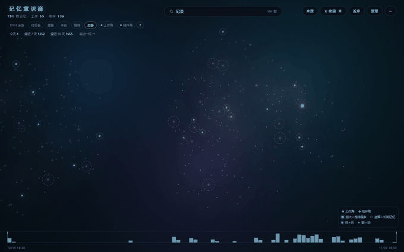
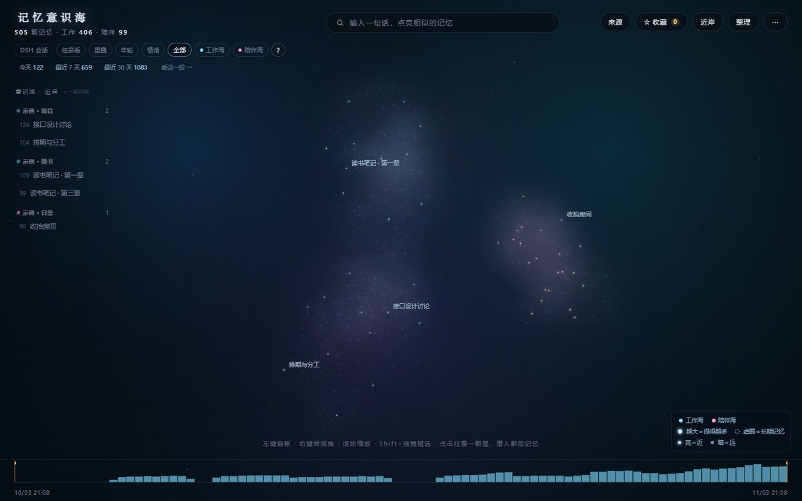
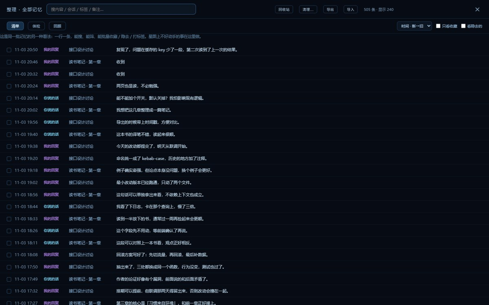
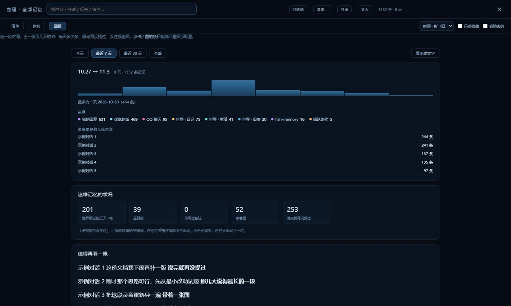
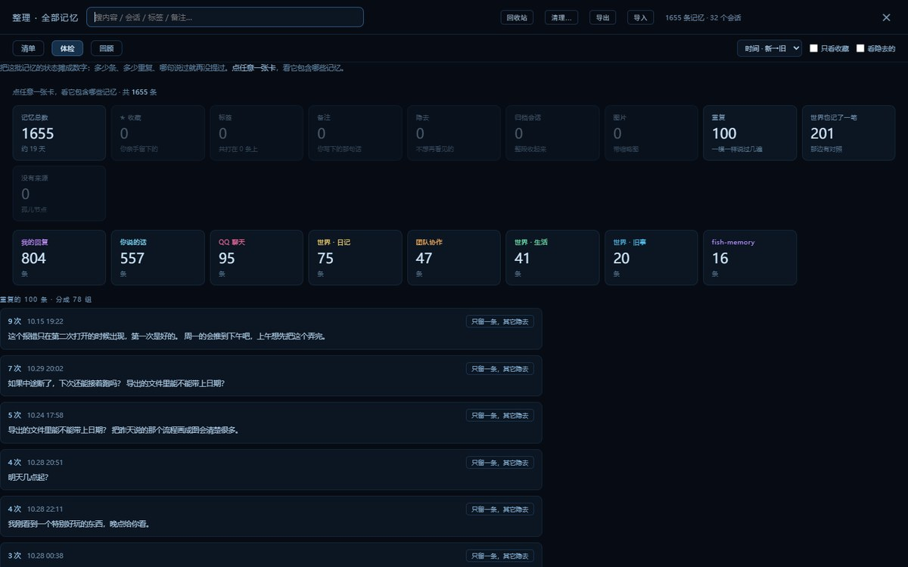
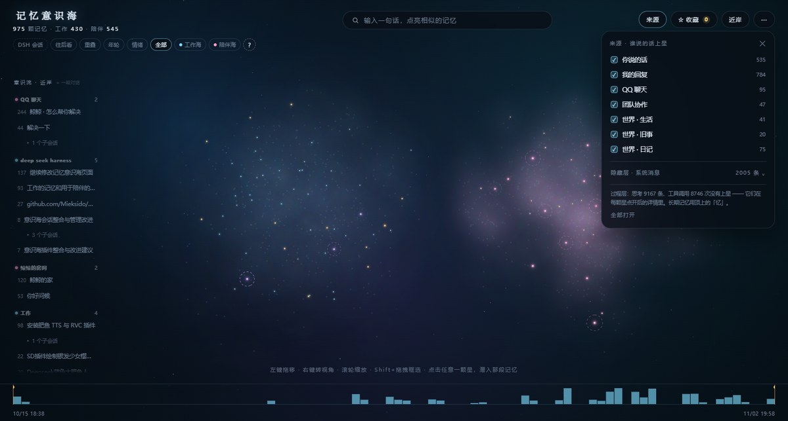
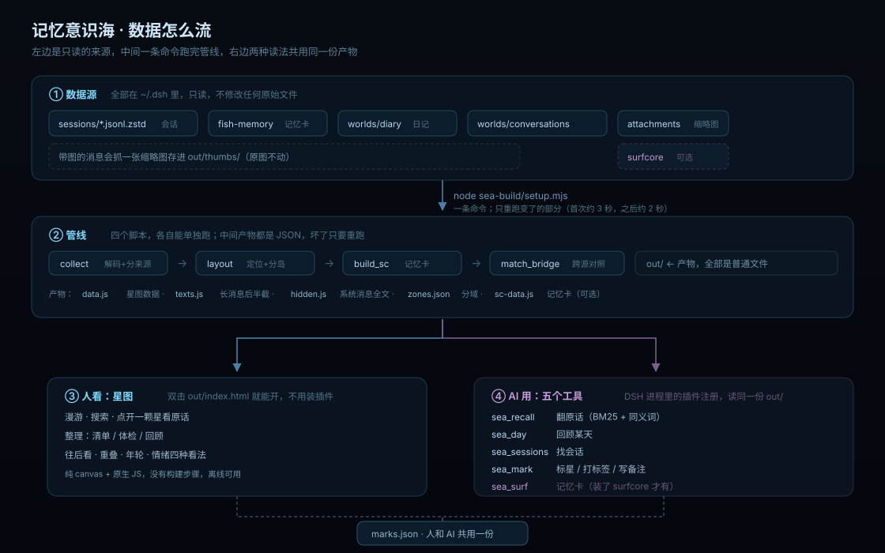

# 记忆意识海 v1.0.0

> **English** — Memory Sea turns every DSH session into a navigable star map: one star per exchange, coloured by source, browsable by time; click a star to read the original words. It also gives the AI a set of tools to recall its own history (`sea_recall` / `sea_day` / `sea_sessions` / `sea_mark`). Zero dependencies, no API keys, everything stays on your machine.

把 DSH 里的**全部会话**变成一片可以看、可以搜、可以整理的星图；
同时给会话里的 AI 一套**查自己记忆**的工具（翻原话、回顾某天、标星）。

人看的是星图，AI 用的是工具，**两边共用同一份数据**。



*拖动漫游 · 滚轮缩放 · 点一颗星看它当时说了什么*（画面里是演示数据，不是任何人的真实对话）

## 30 秒先看看（不用装插件）

1. 下载这个仓库（或 `git clone`）
2. 跑一条命令生成数据 —— `node sea-build/setup.mjs`（约 3 秒）
3. **双击 `sea-build/out/index.html`**

就这样。它是一个纯静态页面：不连网、不起服务、也不读浏览器之外的东西。
左上角切数据源，左栏点会话，顶上搜，右上「整理」是另一套看法。

装插件是为了**在 DSH 里随时打开它**（左下角一个 ✦ 悬浮球），以及**让 AI 用上这些记忆**。

| 星图：一屏全貌 | 整理：按清单翻、批量标 |
|---|---|
|  |  |
| **回顾：选一段时间生成一张卡** | **体检：每张卡都能点开看它包含什么** |
|  |  |
| **来源：七类来源独立开关** | |
|  | |

---

## 它是怎么运转的



四个数据源只读，一条命令跑完管线，产物就是几个普通 JSON/JS 文件；
**人**在星图里看它，**AI** 通过五个工具读它，两边共用同一份 `marks.json`。

---

## 三分钟装上

前置：Node.js ≥ 20、装了 DSH、本机有 Chrome（只影响截图工具，不影响主功能）。

### 1. 生成数据（只有方式 B「clone 到本地」需要）

如果你打算用下面的**方式 A**（插件管理器里装），这一步先跳过 —— 装完再跑，命令里的目录会不一样。

```bash
node sea-build/doctor.mjs    # 先自检：找到几个数据源、缺什么（可选）
node sea-build/setup.mjs     # 一条命令跑完整条管线（首次约 3 秒，之后约 2 秒）
```

跑完 `sea-build/out/` 里会有 `index.html`、`data.js`、`texts.js`、`zones.json` 等。
到这里其实就已经能用了（双击 `index.html`）；下面一步是为了**在 DSH 里打开**和**让 AI 能用**。

### 2. 装进 DSH

**方式 A：插件管理器里直接装（推荐）**

打开 DSH → 插件 → 安装 → 在「Git 仓库」里填：

```
https://github.com/YUN44575/dsh-memory-sea
```

这个仓库根目录本身就是插件包（`package.json` 里声明了 `dsh.bundle`），所以能被直接识别。
装完左下角出现一个 ✦，AI 那边同时多出五个工具。

**插件装好不等于有数据** — 它不会自己去读你的会话，得先生成一次。
到仓库目录（或 `~/.dsh/profiles/<profile>/node_modules/dsh-memory-sea`）里跑：

```bash
node sea-build/setup.mjs
```

还没数据时打开星图，画面上会直接告诉你跑这条命令。

> 装之前如果已经装过旧的 `@local/dsh-plugin-sea`，先把它卸掉 —— 两个都装会有两个悬浮球。

**方式 B：命令行（clone 下来装）**

```bash
git clone https://github.com/YUN44575/dsh-memory-sea
cd dsh-memory-sea
node sea-build/setup.mjs      # 生成数据
node sea-build/install.mjs    # 装进 DSH
```

它会做三件事：往 DSH profile 的 `package.json` 里登记两处（`dependencies` 加一条 `link:`、
`dsh.profile.bundles` 加一项）、把 `dsh-plugin-sea/` 软链到 `node_modules/@local/` 下、
再顺手跑一遍数据生成。**改之前会备份** `.bak-sea-<时间戳>`。

```bash
node sea-build/install.mjs --dry            # 只看会改什么，不动文件
node sea-build/install.mjs --profile web    # 换 profile（默认 desktop）
node sea-build/install.mjs --copy           # 复制而不是软链（想冻结版本时用）
node sea-build/install.mjs --skip-setup     # 只装插件，不重建数据
node sea-build/install.mjs --force          # 目录搬过家，覆盖旧的 link 指向
```

`install.mjs` 装完在 profile 目录跑一次 `pnpm install`（如果 DSH 启动时自己会装，跳过也行）。

<details>
<summary>也可以手动装（两处登记）</summary>

改 `<用户目录>/.dsh/profiles/<profile名>/package.json`：

```jsonc
{
  "dependencies": {
    "@local/dsh-plugin-sea": "link:<本仓库>/dsh-plugin-sea"   // ← 第 1 处
  },
  "dsh": {
    "profile": {
      "bundles": ["…", "@local/dsh-plugin-sea"]                // ← 第 2 处
    }
  }
}
```

再把 `dsh-plugin-sea/` 软链到 `<profile>/node_modules/@local/dsh-plugin-sea`，然后 `pnpm install`。

</details>

插件的数据目录（`root`）有三种写法：
1. 在 `dsh-plugin-sea/cordis.patch.yml` 里写绝对路径（最直白）
2. 留空 `''`，用环境变量 `SEA_DATA_DIR` 指定
3. 留空且不设环境变量 → 默认 `<用户目录>/.dsh/sea-out`

### 4. 重启 DSH

**改 `index.js` 必须重启**（host 半在进程启动时加载）；
之后改 `out/index.html` 或 `client.js` 不用重启，浮层里点 ↻ 就行。

装好后左下角有个 `✦`，点开就是星图。

---

## 装完能得到什么

**页面上**
- 星图：会话变成星，相近的话题聚成云，工作海（青蓝）/ 陪伴海（粉紫）分开
- 点星看原话、缩略图、上下文；Esc 分级退出
- 右上「来源」：按来源分别开关（你说的话 / 我的回复 / QQ / 团队协作…），**能看到团队协作这类平时根本看不到的**
- 「整理」：清单式检索 + 体检（重复/没再提过/带图）+ 按会话折叠 + 回顾卡（选一段时间生成一张卡）
- 收藏 / 标签 / 备注 / 隐去 / 归档，全部存在 `marks.json`（不再只是浏览器 localStorage）

**AI 手上**（装好后 DSH 会话里直接可调用）
| 工具 | 干什么 |
|---|---|
| `sea_recall` | 翻原话：关键词 / 来源 / 时间段 / 分域 |
| `sea_surf` | 翻 SurfCore 的**记忆卡**（**附加**：没装 SurfCore 就不会挂这个工具，见 [附加数据源](docs/EXTRA.md)） |
| `sea_day` | 某天 / 最近几天发生了什么 |
| `sea_sessions` | 列出会话，找"上次聊 XX 的是哪个" |
| `sea_mark` | 把某条收藏 / 打标签 / 写备注 / 隐去（写回 `marks.json`，页面 8 秒内自动出现） |

---

## 数据从哪来、往哪去

只**读**这些地方，不改原始数据。

**核心**（必需，两样）：

| 来源 | 路径 |
|---|---|
| DSH 会话存档 | `<DSH>/.dsh/sessions/**/session.v4.jsonl.zstd` |
| 附件图 | `<DSH>/.dsh/attachments/v1/objects` |

**附加**（可选，有什么接什么）：

| 来源 | 路径 | 文件 |
|---|---|---|
| 长期记忆 | `<DSH>/.dsh/fish-memory/*.json` | 多一类来源 |
| 世界日记 | `<DSH>/.dsh/worlds/default/` | 多一片陪伴海的内容 |
| SurfCore 记忆卡 | `<DSH>/.dsh/surfcore/characters` | 多一片海 + `sea_surf` |

每个都是独立的，详细说明见 **[附加数据源（可选）](docs/EXTRA.md)**。

产物都在 `sea-build/`：`nodes.json`（采集）、`out/data.js`（星图，长消息只带前 200 字）、`out/texts.js`（长消息的后半截，页面打开 0.8 秒后自动补上）、`out/hidden.js`（系统消息全文）、`out/zones.json`（分域表）、`marks.json`（管理态）。

**没有附加的东西也能跑**：缺哪个就少哪一块（`doctor.mjs` 会告诉你怎么回事），不会崩。

---

## 常用命令

```bash
node sea-build/doctor.mjs        # 自检：数据源在不在、产物新不新
node sea-build/setup.mjs         # 更新数据（增量：只解析变过的会话文件，约 2 秒）
node sea-build/synonym-test.mjs  # 同义词表自检：哪些说法搜不到
node sea-build/watch.mjs         # 实时守护：会话一变就重建
```

---

## 目录里都是什么

```
dsh-sea-v1.0.0/
├── README.md              ← 你正在读的
├── CHANGELOG.md
├── dsh-plugin-sea/        ← DSH 插件（host 半 + 前端浮层）
│   ├── index.js           host：静态服务 / marks API / 五个 AI 工具
│   ├── client.js          前端：左下角 ✦ 悬浮球 + 全屏浮层
│   ├── search.js          BM25 + 2-gram + 同义词（零依赖）
│   ├── package.json
│   ├── cordis.patch.yml   挂载配置（root / prefix）
│   ├── locale/            中英文案
│   └── README.md          插件详细文档（工具参数、检索原理、配置）
└── sea-build/             ← 数据管线 + 界面
    ├── out/index.html     界面本体（星图 / 整理 / 详情，纯前端无依赖）
    ├── collect.mjs        采集会话 + 记忆卡 + 日记 → nodes.json
    ├── layout.mjs         语义分岛布局 → out/data.js + out/texts.js + out/zones.json（增量：旧星不复位）
    ├── build_sc.mjs       SurfCore 记忆卡 → out/sc-data.js
    ├── match_bridge.mjs   两片海的重叠桥
    ├── setup.mjs          一条命令跑完上面四步
    ├── doctor.mjs         自检
    ├── paths.mjs          路径解析（配置 > DSH_HOME > 自动探测）
    ├── domains.json       工作 / 陪伴 分域规则
    └── sea.config.json    同义词 / 权重 / 检索参数（改这个不用改代码）
```

---

## 想改什么

| 想改 | 改哪 |
|---|---|
| 哪些会话算「陪伴海」 | `sea-build/domains.json`（改完跑 setup） |
| 搜不到的词 | `sea-build/sea.config.json` 的 `synonyms`（跑 synonym-test 看哪些 ✗） |
| 界面文字/颜色 | `sea-build/out/index.html` |
| 工具行为 | `dsh-plugin-sea/index.js`（改完**重启 DSH**） |
| 数据目录 | `dsh-plugin-sea/cordis.patch.yml` 的 `root` |

---

## 装不上 / 装上了是空的

按你看到的症状对号入座。

### 打开是一片空白，写着「还没有记忆数据」

正常 —— 插件不会自己去读你的会话，得手动跑一次生成。页面会把**完整命令**给你（含插件目录），点「复制」粘到终端里跑就行。
跑完刷新（浮层里点 ↻）。

### 左下角没有 ✦

- 装完必须**重启 DSH**，插件才会被加载
- 重启还没有：看 DSH 的插件页，这个包是不是被标成「未启用」
- 还是不行，看崩溃日志 `%APPDATA%\@deepseek-ai\dsh-desktop\logs\crash-*-web-boot.log`，`--- renderer console ---` 那段才有真话

### DSH 起不来了，提示 `web boot: ... did not activate`

这是插件加载失败，不影响你的数据（数据都在 `~/.dsh` 里）。启动失败对话框里有一个「**禁用第三方插件、备份 profile patch 并重启**」的按钮，先点它把 DSH 救回来，再把上面那个 crash 日志发出来。

### 装的时候 pnpm 报一堆 `ERR_PNPM_` 

大概率不是这个插件的问题，是 profile 的依赖锁坏了。典型长这样：

```
ERR_PNPM_LOCKFILE_MISSING_DEPENDENCY
ERR_PNPM_RESOLUTION_POLICY_VIOLATIONS_UNHANDLED
```

说明 `package.json` 里某个依赖的版本和 `pnpm-lock.yaml` 对不上，而 `pnpm-workspace.yaml` 的供应链白名单（`minimumReleaseAgeExclude`）又没放行那个版本。
在 `~/.dsh/profiles/<profile>/` 下把那个版本加进白名单，然后重建锁：

```bash
# 例：报的是 billion-context@0.1.212
# 编辑 pnpm-workspace.yaml，在 minimumReleaseAgeExclude 里加 "billion-context@0.1.212"
pnpm install --force --lockfile-only
```

### 装完之后 AI 那边的工具不见了

五个工具（`sea_recall` / `sea_day` / `sea_sessions` / `sea_mark` / `sea_surf`）是插件注册的，插件没启用就没有。
其中 `sea_surf` 只有装了 SurfCore 才会出现 —— 没有它不影响其它四个。

## 已知边界（第一版）

- 检索是 **BM25 + 同义词 + 子串**，不是语义向量。换个说法但两边都不含共同词，就搜不到。
- **判重**按整段文本完全相同算，不认"意思一样但措辞不同"。
- **分域**粒度是「会话」不是「话题」：工作会话里聊到陪聊对象的事，仍算工作海。
- **AI 标星**页面最多 8 秒后出现（轮询版本号），不是即时的。
- **数据量**：现在约 1600 节点 / 1 MB。采集和布局都已是增量（只处理变过的会话、旧星坐标不动）；
  到 5 万条主要瓶颈变成 `texts.js` 全量预载，需要按月拆成 `texts-YYYY-MM.js`。
- 只在 Windows + Chrome 上验证过。

---

## 许可

MIT。数据永远在你自己的机器上，没有联网请求。

---

## 还能接什么（可选）

这套东西默认只处理 **DSH 会话本身**。如果你的 DSH 里还装了这些，会多出对应的内容：

- **fish-memory** → 长期记忆条目也上星图，搜索时一起命中
- **dsh-world**（世界日记）→ 它写的日记进陪伴海，你俩对同一件事的两个视角能对照着看
- **SurfCore** → 多一片「衰减中的记忆卡」的海，AI 多一个 `sea_surf` 工具
- **团队协作 / 子代理** → 默认就接（DSH 会话的一部分），能看到 Lead 和子代理来回的那些结论

细分说明（每个源怎么接、没有会怎样、分域怎么调）在 **[docs/EXTRA.md](docs/EXTRA.md)**。
